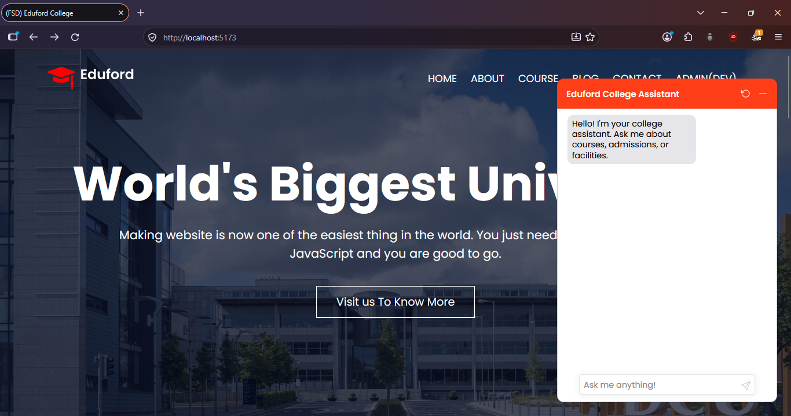

# 🎓 Educational Institution Website

Welcome to the **Educational Institution Website** repository! This project is a fully responsive and modern website designed for educational institutions, built using React.js. THe website features various sections including About Us, Blog, Courses, and Contact Us, each tailored to provide a comprehensive and engaging user experience, now with a RAG based AI Chatbot.

### 🌐 Live Preview

Check out the live version of the website [here](https://react-college-website-with-chatbot-ecru.vercel.app)

### 🌐 Screenshots

Here's a sneak peek of what the website looks like:

### 🛠️ Tech Stack

- **Frontend:** React.js
- **Styling:** CSS
- **Routing:** React Router DOM
- **Backend:** Express
- **Chatbot UI** Deep Chat (React)

---

Thank you for checking out, If you find this project helpful, please consider giving it a ⭐. Special thanks to [2SSK](https://github.com/2SSK) and his project [react-college-website](https://github.com/2SSK/react-college-website), for giving me a solid, neat, easy to maintain foundation for building upon it. This ain't AI speaking.

---
